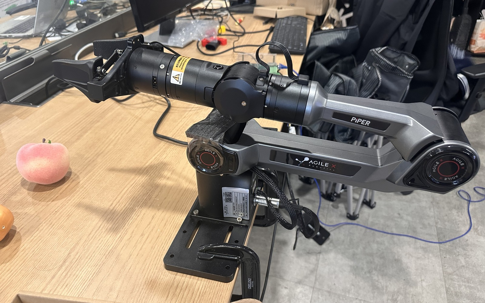

# AgileX Piper + RK3588 NPU YOLO for Robonix

A Robonix deployment for an **AgileX Piper six-axis arm, parallel gripper, Orbbec
Gemini 336L camera, and Rockchip RK3588**. It includes camera and arm primitives,
YOLO oriented bounding box (OBB) detection, grasp-pose estimation, Python inverse
kinematics, a vertical-grasp skill, and an optional voice interaction pipeline.

Inference runs on the host's RK3588 NPU. Robonix, ROS 2 drivers, and manipulation
services run in a ROS 2 Humble container and reach the inference server through
host networking. Normal detection does not require PyTorch, CUDA, or model
conversion. Local packages, the URDF, models, and RKNN runtime are included.

**Current status: software integration and package validation have passed, but
independent validation of the current hardware calibration has not passed.
Physical object grasping has not been validated.** This repository provides a
deployment template that needs site-specific configuration. Historical
calibration matrices and motion poses must be revalidated for each installation.
Demo media is currently omitted.

[Capabilities](#capabilities) · [Architecture](#architecture) ·
[Installation](#installation) · [Configuration and calibration](#configuration-and-calibration) ·
[Start and use](#start-and-use) · [Validation](#validation) · [Stop](#stop) ·
[Package Catalog integration](#package-catalog-integration) · [Troubleshooting](#troubleshooting)



## Capabilities

| Component or service | Provider ID | Function and interface |
| --- | --- | --- |
| Orbbec Gemini 336L | `orbbec_camera` | ROS 2 RGB, depth, and intrinsics; gRPC lifecycle |
| Piper arm and gripper | `piper_ctl` | ROS 2 joint state/commands, end-effector pose/commands, and arm status; gRPC lifecycle |
| Piper body description | `piper_description` | URDF and TF through `robot_state_publisher`; no separately routed capability |
| Local microphone | `audio_mic` | ALSA capture, device enumeration and selection; gRPC |
| Operator audio bridge | `audio_client_bridge` | Remote microphone/speaker; gRPC capabilities and an internal reverse WebSocket |
| Object detection | `llm_detect` | YOLO HTTP / VLM backend adapter; MCP detection interface |
| Grasp-pose estimation | `grasp_pose` | Homography-based conversion from image coordinates to arm-base grasp poses; gRPC |
| Python IK executor | `roboarm_ik` | Inverse kinematics, grasp execution, reset, and placement; gRPC; no MoveIt dependency |
| Speech | `speech` | ASR, wake word, TTS, and dialog; gRPC and MCP |
| Vertical-grasp skill | `pick` | `pick`, `demo`, `grab`, `put_in_box`, and `put_down`; MCP |
| Host NPU detector | No Atlas provider | YOLO11n-OBB HTTP backend at `127.0.0.1:8770` |

The bundled detector recognizes **carrot, potato, and tomato**. The default
pipeline uses a fixed overhead camera, planar hand-eye calibration, and vertical
grasps. The skill undistorts frames, calls the detector, and filters targets with
a consistency check across two frames.

`grab` picks up and holds an object; `put_in_box` carries it to a configured box
position; `put_down` opens the gripper in place; `pick` combines detection,
grasping, and placement; `demo` runs between two configured positions. These
operations can move the physical arm. A VLM backend is also configurable, but
requires a working multimodal endpoint and separate validation.

## Architecture

```text
Operator: rbnx chat / rbnx ask / robonix-client
                         |
           Atlas · Pilot · Executor · Liaison · Soma
                         |
                     pick skill
                         |-- undistort → JPEG → HTTP YOLO → target matching
                         |-- grasp_pose: pixels → arm/base_link
                         `-- roboarm_ik: inverse kinematics → ROS 2 joint commands
                                                            |
                   ROS 2 Humble container                   |
                orbbec_camera                          piper_ctl
                      |                                     |
                USB RGB-D camera                   host SocketCAN → Piper

Host: yolo_npu (RKNN Lite2 → RK3588 NPU, HTTP :8770)
      FunASR (optional, WebSocket :8771)
```

The `llm_detect` service can use the same HTTP backend. The skill's default YOLO
path calls the host detector directly. The NPU support package exposes no Atlas
contract and is not started in the container's `service:` list.

Body hierarchy and description are in [soma.yaml](soma.yaml), and
transforms and geometry are in the [Piper URDF](urdf/piper.urdf).
System and package configuration live in the root
[robonix_manifest.yaml](robonix_manifest.yaml). Packages call each other through
contract IDs; provider IDs and catalog package names are separate identifiers.

## Requirements

| Item | Deployment requirements |
| --- | --- |
| Host | Rockchip RK3588, Linux AArch64, CPython 3.10 |
| Arm | AgileX Piper, gripper, USB-CAN adapter; CAN at 1 Mbps |
| Camera | Orbbec Gemini 336L, preferably USB 3, 1280×720 color |
| ROS | ROS 2 Humble in the container; `rmw_zenoh_cpp` by default |
| Container runtime | Docker Engine with USB access and host networking |
| NPU | RKNPU driver and `/dev/dri/renderD128`; bundled RKNN Lite2/Runtime 2.3.2 |
| Build tools | Git, curl, Python venv, and uv; network access to GitHub and system/Python package repositories |
| Model endpoints | OpenAI-compatible endpoints for Pilot and target-name matching; image input support for VLM detection |
| Optional voice | ALSA microphone or operator audio client; separately downloaded FunASR model and dependencies |

Historical NPU tests used Linux 6.1.118, Python 3.10.12, and RKNPU driver 0.9.8.
The bundled RKNN wheel targets CPython 3.10 / AArch64 and cannot be used directly
on x86_64 or another Python version. The default detector uses FP16 with a
736×1280 input (height×width); camera output is 1280×720 (width×height).

## Installation

### 1. Clone this repository and the pinned Robonix source

```bash
git clone https://github.com/syswonder/robot-agilex-piper-rk3588.git
cd robot-agilex-piper-rk3588

git clone https://github.com/syswonder/robonix.git vendor/robonix
git -C vendor/robonix checkout fb68bc52f9bb9e2bb57337332d32357340d16968
git -C vendor/robonix submodule update --init --recursive
```

Robonix source is fetched separately; see [vendor/PINS.md](vendor/PINS.md) for the
pinned revision. ROS drivers, services, and skills are included under `primitives/`, `services/`, and `skills/`.
Their upstream default branches are not cloned during build or startup, so
upstream changes do not silently replace this deployment's modifications.

### 2. Build the ROS / Robonix container

```bash
bash containers/piper/run.sh -b -e 'rbnx --version'
```

The image is built from [Dockerfile](containers/piper/Dockerfile). Defaults are
`piper-robonix:std-humble-arm64` for the image and `robonix_yolo_dev` for the
container. The repository is mounted at `/root/workspace`; Robonix core source
is built into the image. Subsequent commands do not need `-b`:

```bash
bash containers/piper/run.sh -e 'rbnx --version'
```

The container uses host networking and a `/dev` mount for camera, audio, and
SocketCAN access. The launcher refuses to reuse a container mounted from a
different repository directory. Set `CONTAINER_NAME` to use a distinct name.
The first build downloads ROS, Rust, and Python dependencies; build time depends
on the host and network.

### 3. Install host NPU dependencies

Install Python 3.10, venv support, and uv on the host, then run:

```bash
bash yolo_npu/setup_runtime.sh
```

Dependencies are installed under `yolo_npu/runtime_python/` and `runtime_deps/`,
both excluded from Git. Models, JSON metadata, the original wheels, and
`runtime/librknnrt.so` are included. Startup verifies model/metadata SHA256
checksums. There is no need to copy the runtime library into a system directory.

## Configuration and calibration

### 1. Create a local deployment configuration

```bash
cp robonix_manifest.yaml robonix_manifest.local.yaml
chmod 600 robonix_manifest.local.yaml
```

Edit this **complete manifest copy**. Files matching `*.local.yaml` and
`*.local.env` are ignored by Git; keep actual API keys there. Model names and
URLs in the public template are replaceable historical settings, not a guarantee
that those endpoints are currently available.

| Configuration | Settings to review |
| --- | --- |
| `system.pilot.vlm` | Planner upstream, api_key, model, and api_format |
| `primitive.piper_ctl.config` | `can_port`, 1 Mbps bitrate, USB address, and motor-enable policy |
| `primitive.orbbec_camera.config` | Gemini 330-series launch file, actual image size and frame rate |
| `service.roboarm_ik.config` | URDF path, observation, reset, and placement poses |
| `service.grasp_pose.config` | Site-specific homography, desktop height, and base frame |
| `skill.pick.config` | Matching homography, camera K/D, desktop height, box positions, and motion offsets |
| `skill.pick.config.grab_match_llm_*` | Text model for matching user requests to YOLO labels |
| `service.llm_detect.config.llm_*` / `skill.pick.config.grab_vlm_*` | Working multimodal endpoint and credentials when using VLM detection |
| `env.PIPER_WORKSPACE` | `/root/workspace` in the container; change to the actual root when running directly on a host |

Paths such as `primitive.piper_ctl` identify list entries by their `name`; they
do not mean the YAML lists should be rewritten as dictionaries. The public
manifest disables `auto_enable` and `auto_can_setup` by default.

### 2. Configure CAN

Identify the USB-CAN adapter and interface on the host. The following example
uses `can0`:

```bash
ip -details link show can0
# Only configure an interface that is DOWN and not used by another deployment.
sudo ip link set can0 type can bitrate 1000000
sudo ip link set can0 up
ip -details link show can0
```

Write the actual interface name into the local manifest. Set `auto_enable: true`
only after confirming that automatic motor enable is appropriate for the setup.
**Once motors are enabled, starting the IK service may move the arm to its
observation pose. Booting the stack is not a read-only check.**

### 3. Calibrate camera intrinsics and the planar hand-eye mapping

Follow the [Piper calibration guide](tools/calibration/piper/README.md):

1. Intrinsics: capture checkerboard images at different positions, distances,
   and angles to estimate `camera_matrix` and `dist_coeffs`.
2. Hand-eye mapping: collect corresponding image points in undistorted frames
   and physical points in the arm-base frame; fit the homography.
3. Independent validation: check actual landing positions using points excluded
   from fitting. Resume automatic grasping only after validation passes.

The calibration tool and Robonix drivers must not own the camera/CAN devices at
the same time. Install calibration dependencies separately as described in its
README. The verification page moves the arm. Transfer the results into the local
manifest at the repository root:

| Calibration result | Manifest fields |
| --- | --- |
| Camera matrix K and distortion D | `skill.pick.config.camera_matrix` and `dist_coeffs` |
| Homography H | Both `service.grasp_pose.config.homography_matrix` and `skill.pick.config.homography_matrix` |
| Desktop height | `grasp_pose.default_desktop_height` and `pick.desktop_height`; also review `grasp_offset` |

Both H settings must match. Runtime image size and undistortion must match the
calibration procedure. The current site's independent validation has not passed;
historical matrices and passing software checks do not establish that physical
grasping is ready.

## Start and use

The root `build.sh` and `start.sh` scripts run the same container commands shown
below with `robonix_manifest.local.yaml`. Complete configuration and calibration
before starting the robot.


Run the inference backend, Robonix stack, and operator interface in separate
terminals.

### Terminal 1: host NPU detector

```bash
cd robot-agilex-piper-rk3588
bash yolo_npu/run_yolo_npu.sh
```

Check health from another host terminal:

```bash
curl -fsS http://127.0.0.1:8770/health | python3 -m json.tool
```

`device` should be `rk3588-npu`. Test detection on a bundled sample without
accessing the arm:

```bash
curl -fsS --data-binary @yolo_npu/samples/camera_calibration/calib_006.jpg \
  'http://127.0.0.1:8770/detect?conf=0.5&iou=0.45&object_name=tomato' \
  | python3 -m json.tool
```

`POST /detect` accepts raw JPEG/PNG bytes. `image_size` is `[height, width]`.
OBB angles use radians; the fifth `bbox_2d` element uses degrees. See the
[NPU implementation guide](yolo_npu/README.md) for the response format,
configuration, and model rebuilding.

### Terminal 2: build and boot Robonix

After reviewing calibration, CAN, and motion parameters:

```bash
bash containers/piper/run.sh -e \
  'cd /root/workspace && rbnx build -f robonix_manifest.local.yaml'

bash containers/piper/run.sh -e \
  'cd /root/workspace && rbnx boot -f robonix_manifest.local.yaml --no-update-check --verbose'
```

Startup follows primitive → service → skill orchestration. `pick` is activated
on demand and may initially appear as `INACTIVE`; assess capability registration
and initialization logs before treating that state as a failure.

### Terminal 3: capability checks and chat

```bash
bash containers/piper/run.sh -e 'rbnx caps'
bash containers/piper/run.sh -e 'rbnx tools'

# Open an interactive container shell, then start chat.
bash containers/piper/run.sh
# Inside the container:
rbnx chat
```

Check capabilities and state first. In a calibrated and validated workspace,
example requests include:

```text
What capabilities does this arm have?
Pick up the carrot and keep holding it.
Place the held object in the box.
Release the object currently held by the gripper.
```

For a non-interactive request:

```bash
bash containers/piper/run.sh -e 'rbnx ask "What capabilities does this arm have?"'
```

Motion requests invoke the physical executors. Do not run another grasp task,
direct CAN controller, or calibration movement concurrently. Available tasks
depend on the site's configuration and calibration status.

### Optional: voice interaction

Host speech recognition runs independently of NPU detection:

```bash
bash host-services/funasr/fetch_funasr_model.sh
FUNASR_DEVICE=cpu bash host-services/funasr/run_funasr_server.sh
```

The FunASR model is downloaded separately. See the
[host services guide](host-services/README.md) for dependencies and performance
limitations. The YOLO NPU backend does not automatically accelerate FunASR.
The default wake phrase is `罗伯特` (Luo Bo Te). TTS defaults to
`MockTTSBackend`, which returns silence; recognized text does not imply audible
replies. Configure a real TTS backend for speech output.

When the local microphone and remote audio bridge are both present, explicitly
select the input provider in the client to avoid resolving the shared
`audio/mic` contract to the wrong endpoint. Remote speaker output uses the audio
bridge.

## Validation

### Package checks without starting the arm

```bash
# Example: validate the arm package. Other paths are in catalog/package-paths.json.
bash containers/piper/run.sh -e \
  'cd /root/workspace && rbnx validate primitives/primitive-agilex-piper-arm-rbnx'
```

This checks the manifest without running the package's start command. The
container entry point itself prepares the ROS/Zenoh environment. Repository
[GitHub Actions](https://github.com/syswonder/robot-agilex-piper-rk3588/actions)
run strict catalog preflight validation; see the
[submission preparation guide](docs/PACKAGE_SUBMISSION.md) for rules and reports.

### NPU postprocessing regression tests

After installing NPU runtime dependencies, run on the host:

```bash
PYTHONDONTWRITEBYTECODE=1 PYTHONPATH=yolo_npu/runtime_deps:yolo_npu \
  python3 -m unittest discover -s yolo_npu/tests -p 'test_*.py' -v
```

The four existing tests cover RGB/letterbox handling, DFL and rotated coordinates,
NMS, and empty results. Historical tests at 736×1280 measured approximately
186–199 ms for complete NPU FP16 detection versus 1.33 s for the CPU reference.
These timings include preprocessing and postprocessing, but exclude camera
capture, HTTP transfer, and arm motion. They describe historical sample-image
tests, not full-dataset accuracy or closed-loop grasp success rates.

### Validation status

| Check | Status and scope |
| --- | --- |
| `rbnx validate` for all 11 packages | Passed |
| Strict official catalog checks against local and remote source | Passed; metadata, contracts/IDL, transports, and dependency paths |
| Source repository GitHub Actions | Passed; see Actions for the latest run |
| Four NPU postprocessing regression tests | Passed |
| Independent validation of the current site's hand-eye calibration | Not passed; review sampling and installation parameters |
| Physical grasping, transport, and placement acceptance | Not completed |

## Stop

Stop issuing motion requests and confirm the arm state. Press `Ctrl-C` in the
`rbnx boot` terminal, then in the NPU server terminal. To stop the default
container from the host:

```bash
docker stop --time 10 robonix_yolo_dev
```

Use your container name if it differs. Stopping software does not guarantee that
the arm has returned to a safe pose or powered off; follow the Piper hardware
operating procedure.

## Package Catalog integration

This repository is prepared according to the
[official Submit guide](https://packages.robonix.ai/submit/):

- Public GitHub repository with `main` as its default branch and a root-level
  `robonix_manifest.yaml`.
- Robot catalog name `robonix.robot.agilex.piper_rk3588`; `catalog:` supplies
  version, description, license, tags, and maintainers.
- Dependencies are included and referenced through repository-relative paths.
  Ten bundled Robonix packages and a separate NPU support package each provide a
  `package_manifest.yaml`, README, and the contracts/IDL and resources they need.
- Local variants use the `.piper_rk3588` package-name suffix to avoid colliding
  with upstream entries. Provider and contract IDs are preserved. Every declared
  capability specifies its actual transport.
- The deployment cover is `assets/promo/01.jpg` (1600×1000 JPEG). An icon is
  optional. Local credentials, caches, logs, and build directories are excluded
  from publication.

This deployment is submitted as **A whole robot**, with one entry under
`robots:` in the official `catalog.yaml`. Its bundled dependencies resolve
inside this repository and do not require separate catalog entries. Package source belongs in
this repository, not in the catalog repository. See
[PACKAGE_SUBMISSION.md](docs/PACKAGE_SUBMISSION.md) for validation commands, the
dependency inventory, and source-export instructions.

## Troubleshooting

| Symptom | What to check |
| --- | --- |
| Container mount mismatch | A container with that name belongs to another directory; set a distinct `CONTAINER_NAME` |
| NPU initialization failure | AArch64 / Python 3.10 compatibility, driver, device permissions, RKNN version, and model/JSON pairing |
| Port 8770 already in use | An old CPU YOLO or another NPU instance; run one backend per detector port |
| Camera INIT timeout or no frames | Calibration/other driver ownership, USB connection, Gemini 330 launch file, and image settings |
| No arm state feedback | Actual host CAN interface, UP state, 1 Mbps bitrate, adapter, and arm power |
| Detection works but grasp positions are offset | K/D, H, image size, undistortion order, base frame, and desktop height |
| Target matching or Pilot timeouts | Local model URL/key, endpoint/model availability, and proxy settings |
| Text works but voice does not | FunASR startup and input provider selection; Mock TTS is intentionally silent |

System ports 50051/50061/50081 and audio bridge port 60002 are intended for a
trusted network. The template does not configure public TLS or authentication
for them. For driver, calibration, and deployment log diagnostics, see the
[Piper calibration guide](tools/calibration/piper/README.md) and individual package READMEs.

## Repository layout

```text
assets/promo/01.jpg                Deployment photograph for the catalog
config/                           Soma and calibration configuration
urdf/piper.urdf                    Piper arm and gripper model
primitives/                       Arm, camera, description, and audio primitives
services/                         Detection, grasp poses, IK, and speech
skills/                           Piper vertical-grasp skill
scripts/                          Catalog validation and filtered source export
tools/calibration/                Intrinsics, hand-eye mapping, and verification
containers/piper/                 ROS 2 Humble image and container entry points
host-services/funasr/              Optional host ASR and model download scripts
yolo_npu/                         NPU models, runtime, HTTP server, and tests
catalog/                          Package inventory and publication policy
docs/                             Submission preparation and source provenance
vendor/PINS.md                    Pinned Robonix source acquisition instructions
.github/workflows/                Source repository CI
build.sh, start.sh                Container build and boot entry points
soma.yaml                         Root body description
robonix_manifest.yaml              Root deployment and whole-robot catalog entry
```

Publication is restricted by `catalog/publication.json`. Runtime dependencies,
calibration tools, body assets, and SDK licenses are included. Machine-specific
overrides, generated dependencies, unrelated robot deployments, and experimental
skills are excluded.

## Sources and licenses

Deployment code is provided under [MulanPSL-2.0](LICENSE). Individual packages,
third-party drivers, models, and SDKs retain their own licenses and redistribution
conditions, including Apache-2.0 drivers and the
[RKNN SDK License](yolo_npu/vendor/RKNN-LICENSE).

- [Robonix](https://github.com/syswonder/robonix) and its [documentation](https://book.robonix.ai/): runtime, contracts, Soma, and deployment conventions.
- [docs/UPSTREAMS.md](docs/UPSTREAMS.md): upstream revisions and local package modifications.
- [SOURCES.md](SOURCES.md): deployment provenance and adaptation history.
- [yolo_npu/SOURCES.md](yolo_npu/SOURCES.md): weights, RKNN SDK/runtime provenance, versions, and checksums.
